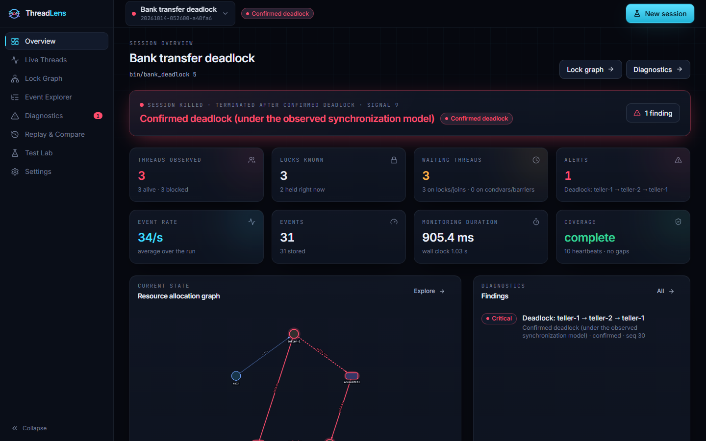
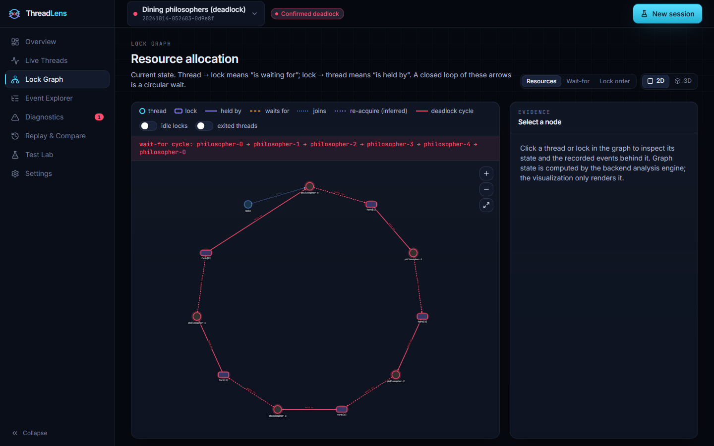
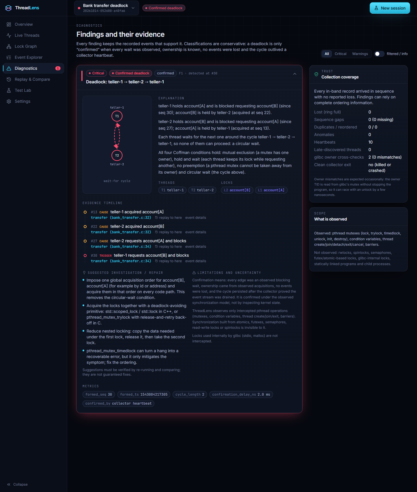
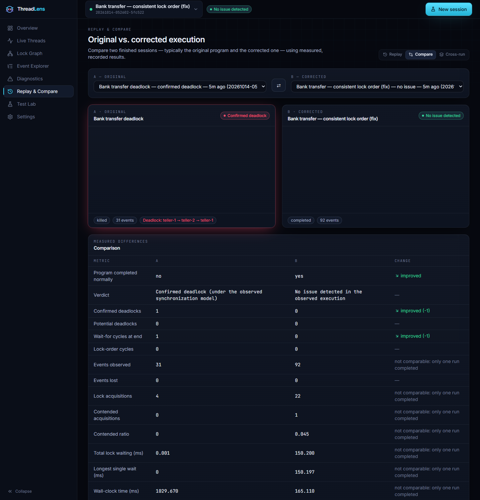
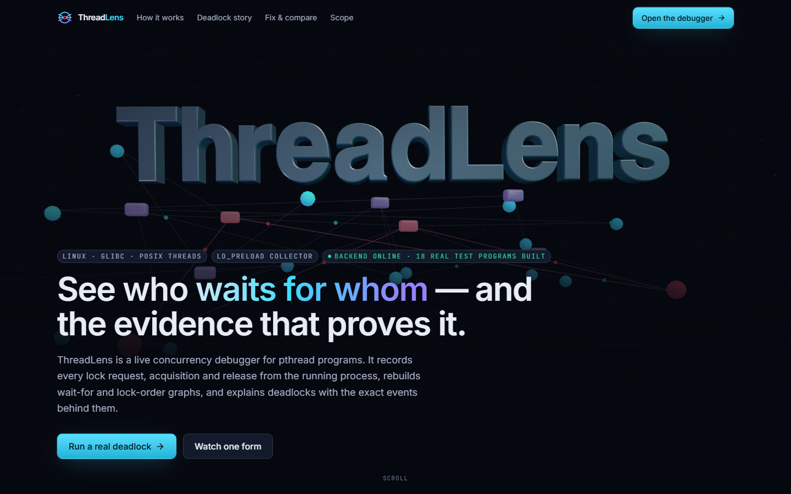

# ThreadLens

**A live Linux concurrency debugger and deadlock visualizer for pthread programs.**

ThreadLens preloads a small collector into an unmodified C/C++ program, records every
mutex and read-write lock request, acquisition and release, condition-variable and
semaphore wait, and thread lifecycle event in order, and streams them to an analysis
backend that rebuilds *who waits for whom*. It confirms real deadlocks with the exact events and source lines behind them,
predicts lock-order inversions, separates contention and stalls from deadlocks, lets you
replay the analysis event by event, and compares an original program with its fix.



| Lock graph — 5-thread dining-philosophers cycle | Diagnosis with ordered evidence and source lines |
|---|---|
|  |  |
| **Original vs. corrected program** | **Cinematic landing page (3D)** |
|  |  |

All screenshots show real sessions of the programs in `scenarios/`.

## What it does

* **Real collection** — `LD_PRELOAD` interposition of `pthread_mutex_*`, `pthread_rwlock_*`,
  `pthread_cond_*`, POSIX semaphores (`sem_wait/trywait/timedwait/post/init/destroy`),
  `pthread_create/join/detach/exit/cancel`, barriers; works for C and C++ (`std::mutex`,
  `std::thread`, `std::scoped_lock`) without recompiling. Lock-free ring buffer, ordered
  sequence numbers, heartbeats, counted event loss.
* **Analysis** — thread states, lock ownership (recursive, error-checking, robust mutexes;
  shared reader sets for rwlocks), current **wait-for graph** (deadlocks, including join,
  self-deadlock, and rwlock cycles where a writer waits for every reader — searched
  depth-first because such a node has several outgoing edges), historical
  **lock-order graph** (potential deadlocks, try-lock aware, read/write modes, GoodLock and
  shared-mode filters, cross-run merge), contention, stalls (lost wake-ups, semaphores
  nobody will post — semaphores have no owner, so they never form wait-for edges),
  pthread API misuse.
* **Conservative verdicts** — *confirmed deadlock* (only with complete coverage and a cycle
  that outlives a collector heartbeat), *potential deadlock*, *contention*, *API misuse*,
  *stall*, *inconclusive*, *no issue detected in the observed execution*.
* **Evidence** — every finding keeps its ordered events, cycle, `file:line` call sites,
  explanation (incl. Coffman conditions), remedies and limitations.
* **Dashboard** — Overview, Live Threads with activity lanes, Lock Graph (2D Cytoscape and
  interactive 3D React Three Fiber), virtualized Event Explorer with exports, Diagnostics,
  Replay & Compare, Test Lab with 23 real scenarios, Settings (theme, reduced motion, 2D/3D,
  thresholds, supported primitives). Cinematic landing page with a 3D hero and a scroll-driven deadlock story.

## Measured results

From `scripts/evaluate.py` (full report: [docs/results.md](docs/results.md)) on WSL2 Ubuntu 26.04, 22 logical CPUs:

| | |
|---|---|
| Evaluation runs (23 scenarios × 5) | **115**, verdict = ground truth in **100 %** |
| Confirmed-deadlock precision / recall | **100 % / 100 %** (35 TP, 0 FP, 0 FN, 80 TN) — incl. the rwlock opposite-order and read-to-write upgrade deadlocks |
| Potential deadlock / contention / stall | 100 % precision and recall each (5 / 5 / 10 positive runs; the stalls include the semaphore bounded-buffer bug) |
| API misuse | 100 % recall (5/5); precision not meaningful — no scenario declares misuse forbidden |
| Deadlock detection latency (end-to-end) | median **2.4 ms**, p95 5.1 ms, max 5.4 ms (35 confirmed deadlocks) |
| Interposition overhead (collector loaded, idle) | ≈ **1.0×** (1.00–1.06×) |
| Trace-file overhead, lock-bound stress | ≈ **1.6–1.9×** |
| Live pipeline, lock-bound stress (lossless) | 4.7× (1 thread) … 33–34× (4–8 threads), bounded by ~210–280 k events/s backend ingest |
| ThreadSanitizer / Helgrind on the same programs | both hung without a report on all 5 actual deadlocks they were run on (incl. both rwlock deadlocks) and on both stalls; both reported the single-run lock-order inversion; Helgrind also flagged the misuse scenario (13 errors) |

The stress numbers are a deliberate worst case (a lock operation every few hundred ns).
See `docs/limitations.md` for what ThreadLens cannot see.

## Quick start

### Windows 11 + WSL2 (how this project was developed)

Requirements: WSL2 with Ubuntu (`wsl --install -d Ubuntu`), Node.js ≥ 20 on Windows.

```powershell
.\scripts\setup_windows.ps1        # builds collector + scenarios in WSL, installs backend, builds UI
.\scripts\start_windows.ps1        # starts the backend in WSL and opens http://localhost:8000
```

### Native Linux (Ubuntu 22.04+)

```bash
sudo apt install build-essential cmake python3-venv python3-pip nodejs npm   # optional; setup bootstraps pip/cmake if missing
scripts/setup_linux.sh             # venv + backend deps, CMake build, collector tests
(cd frontend && npm ci && npm run build)
scripts/run_backend.sh             # http://localhost:8000 (API + UI)
```

For frontend development with hot reload: `cd frontend && npm run dev` → <http://localhost:5173>
(proxies `/api` and `/ws` to the backend).

### Use

1. Open **Test Lab** → **Bank transfer deadlock** → **Run**. A toast reports the confirmed deadlock.
2. **Lock Graph** shows the cycle; **Diagnostics** shows the evidence; **Replay** steps through it.
3. **Run original + fix** runs the buggy and the corrected program and opens the comparison.

Monitor your own program (must be dynamically linked; build with `-g` for source lines):

```bash
THREADLENS_ALLOWED_DIRS=/home/me/project/build scripts/run_backend.sh   # then use "Monitor a compiled executable"
# or record offline and import the trace in the Test Lab / analyze on the command line:
THREADLENS_TRACE=run.tlt LD_PRELOAD=build/lib/libthreadlens.so ./myprog
(cd backend && ~/.threadlens/venv/bin/python -m app.cli analyze ../run.tlt --exe ../myprog)
```

Optional annotations: `#include "threadlens/threadlens.h"` → `tl_name_lock(&m, "accounts[3]")`, `tl_mark("phase 2")`.

## Tests

```bash
(cd build && ctest)                                     # collector: 3 tests (ordering invariants on real traces)
~/.threadlens/venv/bin/python -m pytest -q backend      # 124 tests incl. 20 scenarios through the live API
(cd frontend && npm run typecheck && npm test)          # strict TS + 10 unit tests
python scripts/evaluate.py --reps 5                     # measured evaluation → docs/results.md
```

## Acceptance status

| # | Criterion | Status |
|---|---|---|
| 1 | Start backend and frontend | ✅ `run_backend.sh` serves API + built UI; Vite dev server optional |
| 2 | Launch a real instrumented Linux program | ✅ 23 scenarios / any allowed ELF |
| 3 | Collect actual thread and synchronization events | ✅ `LD_PRELOAD` collector, verified by ctest/pytest |
| 4 | Display thread activity from backend data | ✅ Live Threads (cards + activity lanes) |
| 5 | Track lock ownership and waiting relationships | ✅ |
| 6 | Detect the intentionally created deadlock | ✅ 35/35 runs, median 2.4 ms |
| 7 | Highlight the dependency cycle | ✅ 2D ring layout, 3D pulse, cycle banner |
| 8 | Show the supporting evidence | ✅ ordered events + `file:line` |
| 9 | Inspect the event history | ✅ filters, search, details, virtualized |
| 10 | Reconstruct the graph at a selected event | ✅ checkpointed event replay (tested equal to live) |
| 11 | Run the corrected program | ✅ |
| 12 | Compare the observed results | ✅ with non-comparable metrics marked |
| 13 | Export diagnostic or event data | ✅ CSV, JSON, NDJSON, re-importable raw trace, JSON report |
| 14 | Automated tests pass | ✅ 3 + 124 + 10 |
| 15 | Usable with 3D disabled | ✅ 2D default; "Reduced" effects disables 3D hero, motion, auto-rotation |
| — | Premium dark UI, 3D landing, scroll animations, animated deadlock story, timeline-linked graph, comparison, responsive, reduced-motion | ✅ |
| — | Light theme | ✅ (tuned primarily for dark) |
| — | Comparison with ThreadSanitizer and Helgrind | ✅ measured on 16 scenarios (`docs/results.md` § E) |
| — | User study on diagnosis time | ⚠️ not performed (protocol in `docs/testing.md`) |
| — | Read-write locks and POSIX semaphores | ✅ shared readers in the wait-for graph (DFS/SCC), semaphore stalls; scenarios `rwlock-*`, `sem-*` |
| — | Spinlocks, `sem_open`, multi-process | ⚠️ not supported (future work) |

## Project layout

```
collector/   libthreadlens.so (LD_PRELOAD), wire format header, annotation API, C tests
scenarios/   23 real pthread scenarios (C and C++, 16 programs) + catalog.json (ground truth)
backend/     FastAPI app: detection engine, diagnostics, sessions, storage, API, tests
frontend/    React + TypeScript + Vite + Tailwind + Motion + R3F/Drei + Cytoscape
scripts/     setup/start (Linux, Windows), evaluate.py
docs/        report, architecture, research review, schema, algorithms, testing, results,
             security, limitations, requirements, demo script, viva guide, screenshots
```

## Documentation

* [Project report](docs/report.md) — abstract, problem, objectives, design, results
* [Phase-1 blueprint](docs/blueprint.md) · [Requirements](docs/requirements.md)
* [Literature review & tool comparison](docs/research-review.md)
* [Architecture & data flow](docs/architecture.md) · [Event schema](docs/event-schema.md)
* [Algorithms & pseudocode](docs/algorithms.md)
* [Testing & methodology](docs/testing.md) · [Measured results](docs/results.md)
* [Security](docs/security.md) · [Limitations & future scope](docs/limitations.md)
* [Demo script](docs/demo-script.md) · [Viva Q&A](docs/viva.md)
