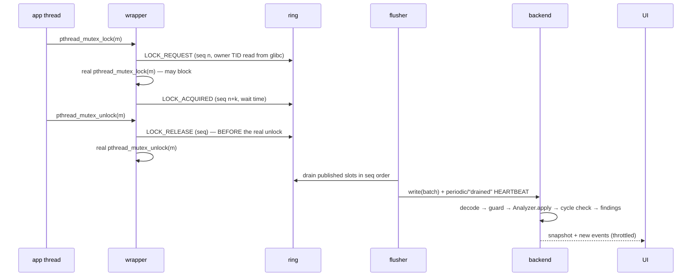

# Architecture

ThreadLens has five layers with narrow, documented interfaces:

| Layer | Code | Interface to the next layer |
|---|---|---|
| Target program | `scenarios/`, any dynamically linked pthread program | ordinary calls into glibc (`pthread_*`) |
| Collector | `collector/src/collector.c` → `libthreadlens.so` | 64-byte binary records on a Unix-domain socket or trace file (`collector/include/threadlens/tl_wire.h`) |
| Analysis engine | `backend/app/detection/`, `backend/app/diagnostics/` | `Analyzer.apply(ev)` / `apply_meta(ev)` / `snapshot()` (pure Python, no I/O) |
| Backend services + API | `backend/app/services/`, `backend/app/api/`, `backend/app/storage/` | REST (`/api/...`) and WebSocket (`/ws/sessions/{id}`) JSON |
| Dashboard | `frontend/src/` | renders snapshots and events; never decides anything itself |

## System architecture

```mermaid
flowchart LR
  subgraph Target["Target process (unmodified)"]
    APP[application threads] -->|pthread_mutex_lock …| HOOK[libthreadlens.so wrappers]
    HOOK -->|dlsym RTLD_NEXT| LIBC[glibc NPTL]
    HOOK -->|claim slot = seq| RING[(lock-free ring, 65 536 slots)]
    RING --> FL[flusher thread: batch, heartbeat, loss report]
  end
  FL -->|AF_UNIX stream, 0600 socket| RX
  subgraph Backend["FastAPI backend (Linux)"]
    PM[process manager: execve, setsid, prlimit, timeout, killpg] -.launches.-> Target
    RX[receiver: decoder + token check] --> SG[sequence guard: dedupe / reorder / gaps]
    SG --> AN[Analyzer: state, wait-for graph, lock-order graph]
    AN --> FD[findings + evidence]
    SG --> WR[SQLite writer thread]
    FD --> WR
    SYM[symbolizer: nm / addr2line] --> FD
    AN --> BC[broadcaster ≤10 Hz, bounded per-client queues]
    WR --> API[REST: events, replay, export, compare, cross-run]
  end
  BC -->|WebSocket| UI
  API --> UI
  subgraph UI["React dashboard"]
    P[Overview · Threads · Graph 2D/3D · Events · Diagnostics · Replay/Compare · Test Lab · Settings]
  end
```

## Data flow of one lock operation

## Collector (`libthreadlens.so`)

* **Interposition.** The library is injected with `LD_PRELOAD`. Because the
  dynamic linker searches preloaded objects first, the program's PLT entries for
  `pthread_mutex_lock`, `pthread_cond_wait`, `pthread_create`, … bind to the
  wrappers. Each wrapper calls the real function obtained once with
  `dlsym(RTLD_NEXT, …)` (`dlvsym(..., "GLIBC_2.3.2")` for the versioned
  condition-variable symbols). No recompilation is needed; C++ `std::mutex`,
  `std::thread` and `std::condition_variable` are covered because libstdc++
  calls the same pthread functions.
* **Intercepted functions.** mutex init/destroy/lock/trylock/timedlock/
  clocklock/unlock; cond wait/timedwait/clockwait/signal/broadcast; thread
  create/join/detach/cancel/exit/setname; barrier wait. Optional annotations:
  `tl_name_lock()`, `tl_mark()` (`threadlens.h`, resolved at runtime with
  `dlsym(RTLD_DEFAULT)` so un-instrumented runs still work).
* **Ordering rule** (the property the analysis relies on):
  `LOCK_REQUEST` before the real lock, `LOCK_ACQUIRED` after it returns,
  `LOCK_RELEASE` **before** the real unlock, `COND_WAIT_BEGIN` before
  `pthread_cond_wait` (which releases the mutex inside) and `COND_WAIT_END`
  after it returns (mutex re-acquired). Hence, for every mutex, a release always
  has a smaller sequence number than the next acquisition by another thread.
* **Ring buffer.** Dmitry Vyukov's bounded MPMC queue used as MPSC: a producer
  claims a slot with one compare-and-swap on the tail; *the slot position is the
  event's sequence number*, so sequence numbers form a single total order with
  no extra counter. The flusher drains published slots strictly in order.
* **Back-pressure and loss.** Application threads never perform I/O. When the
  ring is full a producer spins/yields for at most `THREADLENS_BLOCK_US`
  (default 100 ms), then drops the event and increments a counter. The flusher
  reports drops (`EVENTS_LOST`) and every heartbeat carries the total, so the
  backend always knows whether its picture is complete.
* **Heartbeats.** Every 100 ms, and additionally ~2 ms after the ring drains
  following activity, the flusher sends `HEARTBEAT(seq = next undelivered)`.
  A heartbeat therefore proves "every event with a smaller sequence number has
  been delivered" — used to confirm deadlocks quickly.
* **Lifecycle.** Constructor: connect, handshake (`HELLO` with session token and
  PIE load bias), register the main thread, start the flusher. TLS-key
  destructor: `THREAD_EXIT` for return, `pthread_exit` and cancellation.
  Destructor: `PROCESS_EXIT`, drain, final heartbeat. `fork()` children disable
  the collector; the `THREADLENS_*` variables are removed so exec'd children are
  not monitored.
* **glibc cross-check.** Each `LOCK_REQUEST` carries the owner TID stored by
  glibc inside the mutex (`__data.__owner`), an independent view used to
  corroborate the tracked ownership.

## Backend

| Module | Responsibility |
|---|---|
| `models/wire.py` | struct layout, `StreamDecoder` (validates magic, version, type) |
| `models/events.py` | Pydantic public schema (`EventOut`), strict import schema (`EventIn`), request models |
| `detection/ingest.py` | `SequenceGuard`: drops duplicates, restores order within a window, declares gaps |
| `detection/model.py` | `ThreadInfo`, `LockInfo`, `CondInfo`, `Wait`, `WaitEdge`, `Coverage` |
| `detection/graphs.py` | functional-graph cycle walk, lock-order graph with BFS cycle search, Tarjan SCC |
| `detection/engine.py` | `Analyzer`: event handlers, classification, evidence, snapshot, verdict |
| `diagnostics/findings.py` | `Finding`, `Evidence`, classification vocabulary, remedies |
| `services/process_manager.py` | executable/argument validation, spawn, limits, timeout, kill |
| `services/session.py` | `LiveSession` (socket server, ingest, supervision, broadcast), `SessionManager`, imports |
| `services/replay.py` | checkpointed event replay |
| `services/compare.py` | A/B comparison, cross-run lock-order merge |
| `services/symbolizer.py` | `nm` (data symbols for lock names), `addr2line` (call sites) |
| `services/timeline.py` | per-thread state lanes with severity-preserving down-sampling |
| `services/eventview.py` | stored row → public event JSON with descriptions |
| `storage/db.py` | SQLite schema, background writer thread, queries |
| `api/routes.py`, `api/ws.py` | REST and WebSocket endpoints |

### Why the analysis engine is pure
`Analyzer` performs no I/O and reads no clocks: time comes only from event
timestamps. The same object is driven by live sessions, imported traces,
event replay and the unit tests, so the replayed graph at sequence *n* is
**identical** to the live one (verified by `test_replay_matches_incremental_analysis`).

### Concurrency inside the backend
One asyncio event loop receives sockets, runs the analyzer and serves the API.
SQLite writes go to a dedicated writer thread through a bounded queue; reads use
per-thread connections in WAL mode. Symbolization subprocesses run in worker
threads. WebSocket subscribers have bounded queues; when a client is slow the
oldest update is dropped (each update is a full, self-contained snapshot).

### Sessions and storage
`sessions` (metadata, final snapshot, metrics, captured output), `events`
(primary key `(session_id, seq)`, indexed by thread, lock and type),
`meta_events` (heartbeats and loss reports with the in-band sequence number
after which they were applied — needed for exact replay), `findings`,
`settings`. The database lives in `~/.threadlens/` on the Linux file system
(WAL mode does not work on WSL's DrvFs).

## Dashboard

React 19 + TypeScript + Vite. State is held in small external stores
(`services/store.ts`) read through selectors, so a 10 Hz stream re-renders only
components whose slice changed. The live stream (`services/session.ts`) keeps
the last 1 500 events and falls back to REST if the WebSocket closes.

* 2D graphs: Cytoscape.js (`visualization/Graph2D.tsx`); elements are diffed
  in place so graph updates animate instead of re-laying out.
* 3D graph: React Three Fiber + Drei (`visualization/Graph3D.tsx`); a
  deterministic 3D force layout, nodes lerp to new positions, flow particles
  on waiting edges, cycle nodes pulse. Geometries and materials are created
  declaratively and disposed by R3F on unmount.
* Landing page: R3F hero scene (`visualization/HeroScene.tsx`) paused when
  scrolled away; scroll-driven deadlock story (`visualization/DeadlockStory.tsx`).
* Motion for React for transitions; `prefers-reduced-motion` and a
  "Reduced" setting disable animation, parallax and the 3D hero; the 2D graph is
  always available.

## Technology choices

| Choice | Reason | Alternatives considered |
|---|---|---|
| `LD_PRELOAD` interposition | no recompilation, works for C and C++, sees exactly the pthread API with arguments and return codes, no root needed | eBPF uprobes (needs root, not available here), Valgrind (100× slowdown), compiler instrumentation (needs rebuild) |
| Binary 64-byte records | fixed size → lock-free ring slots, `struct.iter_unpack` decodes ~0.9 M records/s in Python | JSON lines (≈5–10× slower to produce and parse) |
| Unix-domain socket | local, ordered, flow-controlled, permission-checked by the kernel | pipes (no connect-by-path), TCP (unneeded network exposure) |
| Python + FastAPI + Pydantic | readable analysis code for an OS course; first-class WebSocket support; validated API models | Go/Rust backend (faster, harder to explain) |
| SQLite (WAL) | zero-administration persistence with indexed queries for the event explorer and replay | flat files (no random access), PostgreSQL (heavyweight) |
| React + TypeScript + Vite + Tailwind | typed UI, fast builds, design tokens via CSS variables | — |
| Cytoscape.js | mature 2D graph rendering, layouts, selection, styling | React Flow (better for editors than for dense graphs) |
| Three.js / React Three Fiber / Drei | declarative 3D integrated with React state; Drei helpers for labels, controls | raw Three.js (more imperative code) |
| Motion for React | declarative transitions, scroll-linked values, `reducedMotion` support | CSS only (no scroll-linked values) |
| Recharts, TanStack Virtual, lucide-react | charts, virtualized event list, icons | — |
