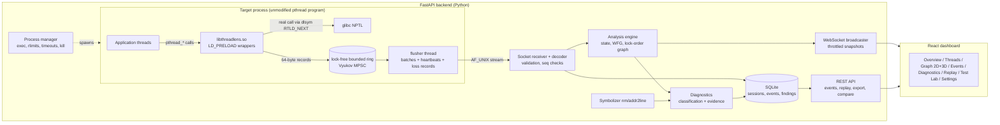
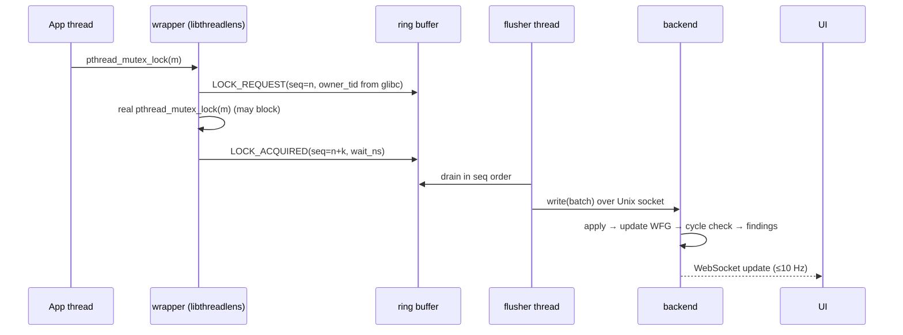

# ThreadLens — Phase 1 Blueprint (Research, Specification, Architecture)

> Status: this blueprint was written **before** implementation and is kept as the
> design record. Where the implementation later diverged, the change is noted in
> the relevant document (`architecture.md`, `algorithms.md`, `limitations.md`).

## 0. Development environment (inspected, not assumed)

| Item | Finding | Consequence |
|---|---|---|
| Host OS | Windows 11 | Linux parts must run in WSL2 |
| Linux | WSL2 Ubuntu 26.04, kernel 6.18 (real Linux kernel), glibc 2.43, gcc/g++ 15.2, GNU make, binutils (`nm`, `addr2line`) | Collector + scenarios + backend run on real Linux |
| Missing in Linux | `cmake`, `pip`/`ensurepip`, `valgrind`, `perf`, `bpftrace`, no password-less sudo | cmake is installed from PyPI into the project venv; pip bootstrapped with `get-pip.py`; Helgrind comparison requires the user to `sudo apt install valgrind` |
| Sanitizers | `gcc -fsanitize=thread` works | ThreadSanitizer is used as a comparison baseline |
| Node | Node 24 / npm 11 on Windows | Frontend dev server runs on Windows (or on Linux, if Node is installed there) and reaches the backend through WSL2 localhost forwarding |

## 1. Understanding of the project

ThreadLens is a **dynamic (runtime) concurrency debugger for Linux pthread programs**.
An interposition library (`libthreadlens.so`, injected with `LD_PRELOAD`) wraps
pthread synchronization calls inside an unmodified, dynamically linked target
program, timestamps and sequences each operation, and streams compact binary
records over a Unix-domain socket to a Python analysis backend. The backend
rebuilds thread state, lock ownership, a *current wait-for graph* and a
*historical lock-order graph*, classifies problems conservatively, keeps the
evidence that supports each finding, persists everything to SQLite and pushes
live updates to a React dashboard. Recorded sessions can be stepped through
event by event (event replay) and two sessions (original vs. corrected program)
can be compared.

It is **not** a data-race detector (that is Helgrind/DRD/TSan territory), not a
kernel lock profiler (`perf lock`, lockdep), and not a deterministic
record-and-replay system (`rr`).

## 2. Problem statement and measurable objectives

**Problem.** Deadlocks and lock-ordering bugs in pthread programs are
intermittent, leave the process silently hung, and existing tools either
(a) report a textual warning after the fact (Helgrind, TSan), (b) measure
contention without explaining causality (`perf lock`), or (c) record entire
executions at high cost without explaining synchronization (`rr`).
Students and developers lack a tool that shows *who waits for whom, since
when, and which recorded events prove it*, live and after the fact.

**Objectives (each is measurable and is evaluated in `docs/testing.md`):**

| # | Objective | Metric | Target |
|---|---|---|---|
| O1 | Detect real deadlocks in instrumented pthread programs | recall on deadlocking scenarios | 100 % of seeded deadlocks across repeated runs |
| O2 | Never report a confirmed deadlock where none exists | precision of "confirmed deadlock" | no false confirmed deadlocks on the non-deadlocking scenarios |
| O3 | Report lock-order inversions as *potential* | potential-deadlock recall on inversion scenarios | inversion found in single-run and cross-run modes |
| O4 | Fast detection | latency from cycle-forming event to confirmed alert | measured and reported (expected < 0.5 s, bounded by heartbeat period) |
| O5 | Bounded interference with the target | overhead vs. un-instrumented baseline on the stress program | measured and reported honestly |
| O6 | Lossless or explicitly lossy collection | events lost, reported to the user | every loss is counted and downgrades verdicts to *inconclusive* |
| O7 | Explain findings | each finding carries ordered event evidence, graph cycle, source locations, remedies, limitations | 100 % of findings |
| O8 | Replay | graph reconstructed at any recorded sequence number equals the live state at that point | verified by automated test |

## 3. Research-backed competitor review (summary — full review in `research-review.md`)

| Tool / work | Problem addressed | Approach | Bug classes | Visualization | Key limitations / cost |
|---|---|---|---|---|---|
| **Valgrind Helgrind** | races, lock-order, pthread misuse | dynamic binary instrumentation; happens-before race detection; lock-order graph checked on every acquisition | data races, potential deadlocks (lock-order cycles), API misuse | textual reports with stacks | "slowdowns on the order of 100:1 are not unusual"; for >2-lock cycles not all locks are shown; condvars only partially handled; spinlocks unsupported |
| **Valgrind DRD** | data races, contention, API misuse | dynamic binary instrumentation, happens-before | races, lock hold-time contention (`--exclusive-threshold`), API misuse | textual | no lock-order/deadlock detection documented; 20–50× slowdown |
| **ThreadSanitizer** | data races (+ optional deadlock detector) | compile-time instrumentation + runtime; `detect_deadlocks=1` reports `lock-order-inversion (potential deadlock)` | races, lock-order inversions | textual with stacks | requires recompilation; upstream test `must_deadlock.cpp` is an expected failure because cycles are checked after the lock is acquired, so an actual hang can go unreported |
| **Linux `perf lock`** | lock statistics/contention | kernel tracepoints / BPF | kernel lock contention | text tables | targets kernel locks; does not reconstruct user-space pthread ownership or deadlock cycles |
| **lockdep** | kernel locking correctness | lock *classes*, dependency graph L1→L2 "means the order ever happened" | potential kernel deadlocks, IRQ-safety | kernel splat | kernel only |
| **eBPF / bpftrace** | ad-hoc tracing | uprobes on `pthread_mutex_lock` (in libc since glibc 2.34) or glibc SDT probes | whatever the script measures | text/histograms | needs root/CAP_BPF; no built-in deadlock analysis; not available in this environment |
| **rr** (O'Callahan et al., USENIX ATC 2017) | deterministic record & replay | user-space recording of nondeterministic inputs, single-core execution | any bug, re-executed deterministically | gdb | serializes threads onto one core; no concurrency diagnosis by itself |
| **GoodLock → IBM (Agarwal, Bensalem, Farchi, Havelund, Nir-Buchbinder, Stoller, Ur, Wang, IBM J. R&D 2010)** | deadlock *potentials* | lock graph from nested acquisitions; filters for single-thread cycles, gate locks, non-parallel segments; merge multiple runs | resource deadlock potentials | — | potential ≠ real; Java focus |
| **DeadlockFuzzer (Joshi, Park, Sen, Naik, PLDI 2009)** | confirm real deadlocks | imprecise cycle prediction + randomized scheduler to reproduce | real deadlocks | — | Java prototype |
| **Dimmunix (Jula et al., OSDI 2008)** | avoid recurrence | deadlock signatures, avoidance at runtime | previously seen deadlocks | — | avoidance, not diagnosis |
| **SPDOffline / SPDOnline (Tunç, Mathur, Pavlogiannis, Viswanathan, PLDI 2023)** | sound prediction | sync-preserving deadlocks, linear time per abstract pattern | predictable deadlocks | — | algorithmic; no developer UI |
| **ThreadRadar (Moseler, Kreber, Diehl, J. Visualization 2022)** | understanding thread behavior | statistical profiling, thread clustering, glyphs in IDE | performance/concurrency comprehension (Java) | in-IDE glyphs | Java; sampling, not synchronization causality |

**Gap ThreadLens addresses.** The surveyed detectors either predict or report;
the visualizers show activity but not causal lock evidence. None of the
surveyed pthread-oriented tools combine (1) live, low-overhead user-space
synchronization collection, (2) a *distinction* between a confirmed current
wait-for cycle and a historical lock-order potential, (3) evidence-linked
explanations, and (4) a timeline from which the graph at any recorded event can
be reconstructed.

## 4. Proposed (qualified) contribution

> An evidence-linked, time-aware concurrency debugging **workflow** for Linux
> pthread programs that combines live event collection, conservative deadlock
> classification (confirmed vs. potential vs. inconclusive), interactive graph
> reconstruction and post-run event replay.

The contribution is **integration, evidence model and usability**, not a new
detection algorithm. The algorithms (wait-for-graph cycle detection,
GoodLock-style lock-order graphs, gate-lock and single-thread filters,
cross-run merging) are established and are cited as such. Engineering
contributions that we can defend:

1. **Ordering-preserving collection**: the record order of lock/unlock events is
   chosen so that the per-process sequence number is a valid linearization of
   lock ownership changes (release recorded *before* the real unlock, acquire
   *after* the real lock returns), which is what makes a wait-for cycle
   trustworthy without stopping the program.
2. **Two-source ownership evidence**: each lock request also captures the owner
   TID that glibc itself stores in the mutex (`__data.__owner`), so the
   tracked owner can be cross-checked against the C library's view.
3. **Confirmation rule with coverage**: a cycle is *confirmed* only if every
   edge is a blocking request on a supported primitive, ownership is known,
   no events were lost, and the cycle persists across a collector heartbeat
   that proves the stream was drained; otherwise it is *potential* or
   *inconclusive*.
4. **Try-lock-aware lock-order graph**: acquisitions made with `trylock`
   cannot block, so they never create lock-order edges; timed acquisitions
   create edges marked *bounded*. (Helgrind lists try-lock handling as a known
   source of false lock-order errors.)

Novelty claims are limited to what is evaluated in `docs/testing.md`.

## 5. Feature lists

**MVP (must work end-to-end for the demo):**
LD_PRELOAD collector (mutex, condvar, thread lifecycle, join, barrier); binary
event transport with sequence numbers, heartbeats and loss counters; analysis
engine (state, wait-for graph, lock-order graph, cycle detection,
classification, evidence); FastAPI backend (sessions, process supervision with
timeouts/limits, SQLite persistence, WebSocket streaming, export, compare,
replay); React dashboard (Overview, Live Threads, Lock Graph 2D, Event
Explorer, Diagnostics, Replay & Compare, Test Lab, Settings); real C/C++
scenarios; automated tests.

**Advanced:** 3D graph (React Three Fiber) driven by real analysis data; 3D
cinematic landing page; scroll-driven deadlock formation story; animated
original-vs-corrected comparison; reduced-motion and 2D fallbacks; cross-run
lock-order analysis; source-line symbolization (`addr2line`); ThreadSanitizer
comparison; benchmark harness.

**Future scope:** rwlocks, semaphores, spinlocks; eBPF uprobe collector for
statically linked binaries; deterministic replay integration with `rr`;
happens-before filtering of infeasible lock-order cycles (SPD-style); remote
targets; multi-process (`fork`) tracking.

## 6. Architecture and data flow



**Data flow of one lock operation**



## 7. Folder structure

```
threadlens/
├── README.md
├── CMakeLists.txt            # builds collector + scenarios
├── docs/                     # blueprint, architecture, research review, schema, algorithms, testing, security, limitations, viva, demo
├── collector/
│   ├── include/threadlens/   # tl_wire.h (wire format), threadlens.h (optional annotation API)
│   ├── src/collector.c       # LD_PRELOAD interposition library
│   └── tests/                # C-level collector tests
├── scenarios/
│   ├── common/scenario.h
│   ├── healthy/ deadlock/ corrected/ contention/ producer-consumer/
│   ├── lock-order/ lifecycle/ misuse/ stress/ philosophers/ join-deadlock/ cond-stall/
│   └── catalog.json          # metadata + expected outcomes (ground truth for evaluation)
├── backend/
│   ├── app/{api,core,detection,diagnostics,models,services,storage}
│   ├── tests/
│   └── requirements.txt
├── frontend/src/{components,pages,hooks,services,types,visualization,utils}
├── scripts/                  # setup, build, run, evaluate, compare-with-tsan
└── tests/                    # end-to-end evaluation harness
```

## 8. Major technical risks and mitigations

| Risk | Mitigation |
|---|---|
| Interposition recursion (wrappers calling pthread functions, `dlsym` allocating) | thread-local re-entrancy guard; initial-exec TLS; collector-internal threads flagged; real symbols resolved once |
| Versioned glibc symbols (`pthread_cond_*` has GLIBC_2.2.5 and GLIBC_2.3.2 versions) | resolve with `dlvsym(..., "GLIBC_2.3.2")`, fall back to `dlsym` |
| Event ordering vs. real lock ordering | record release *before* real unlock and acquire *after* real lock; sequence number = ring slot index (single total order) |
| Monitoring blocks or slows target | lock-free bounded ring; target never performs I/O; bounded spin then drop with counted loss |
| Loss/gaps make diagnosis wrong | loss counters, heartbeats, gap/duplicate detection; any loss → *inconclusive* |
| Deadlocked test process never exits | supervisor timeout; kill whole process group (`setsid` + `killpg`); cannot unwind individual blocked threads safely |
| Python throughput | struct-based batch decoding, O(1) state updates, functional-graph cycle walk instead of full graph search per event, batched SQLite writes on a writer thread, throttled UI updates |
| Static mutex types unknown (no `pthread_mutex_init`) | read glibc `__data.__kind` at each request (documented glibc dependency) |
| WSL2 specifics (DrvFs has no AF_UNIX/SQLite WAL support) | sockets in `/tmp/threadlens-<uid>` (0700), database under `~/.threadlens` |
| 3D cost on weak GPUs | 2D graph is primary; 3D optional; reduced-effects mode; geometry/material disposal |

## 9. Roadmap and acceptance criteria

| Phase | Deliverable | Exit test |
|---|---|---|
| 1 | this blueprint, schema, scope | reviewed |
| 2 | collector + scenarios | trace of `deadlock` scenario contains REQUEST/ACQUIRED pairs forming a cycle; scenarios build with CMake |
| 3 | analysis engine | pytest unit tests for state, graphs, cycles, classification |
| 4 | backend | API + WebSocket tests; real scenario end-to-end test |
| 5 | dashboard | type-check + build; live session in browser |
| 6 | 3D, motion, replay, compare | manual verification + reduced-motion/2D fallback |
| 7 | evaluation | `scripts/evaluate.py` produces measured precision/recall/latency/overhead |
| 8 | docs, viva, demo | every advertised feature implemented or listed as future work |

Final acceptance criteria are tracked in `README.md` → *Acceptance status*.
