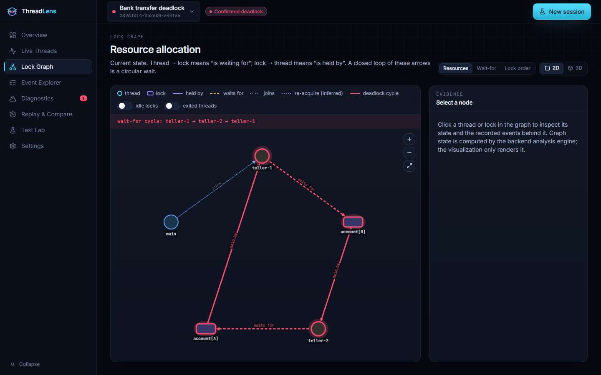
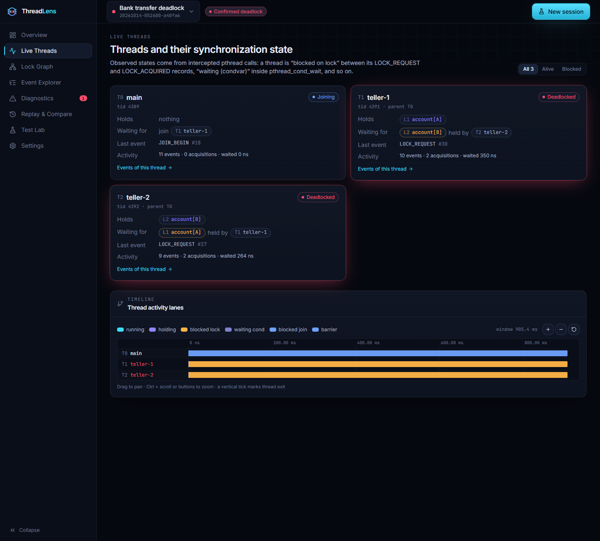
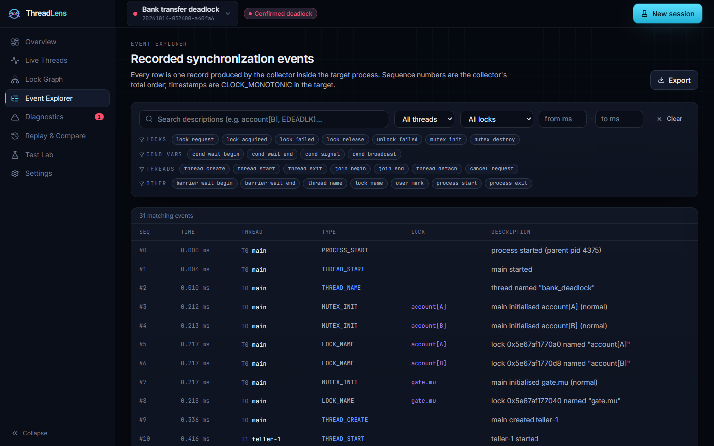
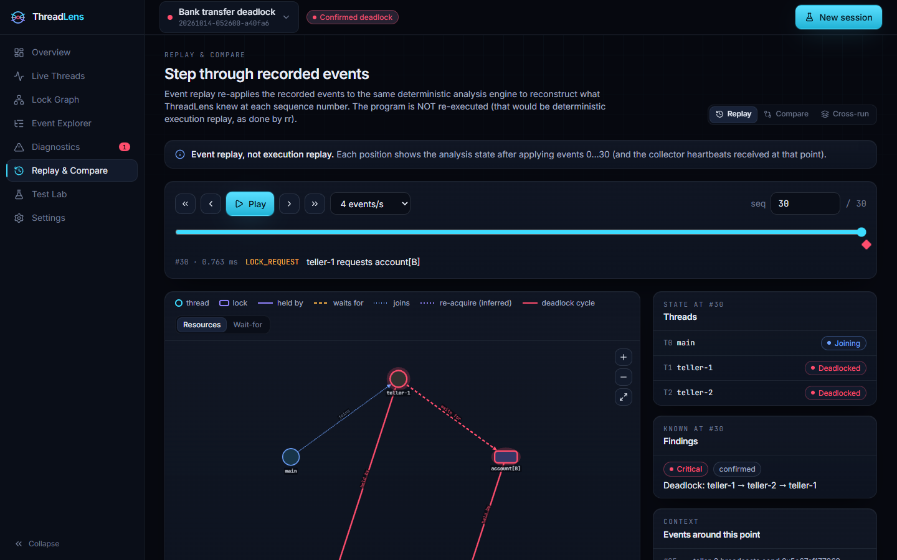
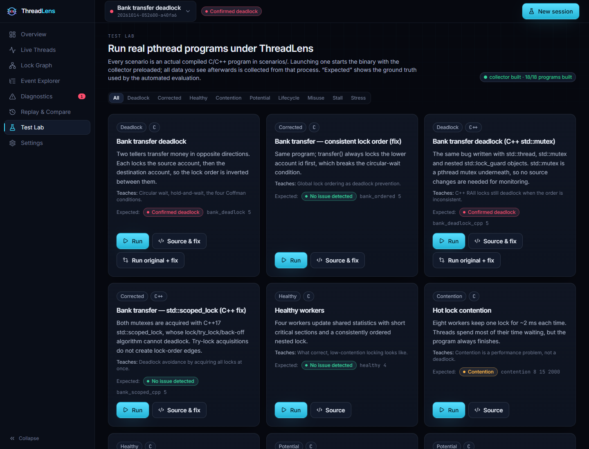

# ThreadLens: A Live Linux Concurrency Debugger and Deadlock Visualizer

*Operating Systems course project — project report*

## 1. Abstract

Deadlocks and lock-ordering bugs in multithreaded programs are intermittent, leave a
process silently hung, and are hard to explain with general-purpose debuggers. ThreadLens
is a runtime concurrency debugger for Linux POSIX-thread programs. A preloaded collector
(`LD_PRELOAD`) records every mutex request, acquisition and release, condition-variable
wait, and thread lifecycle event of an unmodified C/C++ program into a lock-free ring buffer
whose slot indexes form a single total order; a flusher streams the records over a
Unix-domain socket to a Python analysis engine. The engine maintains thread states and lock
ownership, a current wait-for graph and a historical lock-order graph, and classifies
problems conservatively as confirmed deadlocks, potential deadlocks, contention, stalls,
API misuse or inconclusive results, keeping the ordered events and source lines that support
each finding. A React dashboard visualizes the state live in 2D and 3D, replays the analysis
event by event, and compares an original program with its fix. On 18 real scenarios
(90 evaluation runs) every session verdict matched the ground truth, confirmed-deadlock
precision and recall were 100 %, and deadlocks were confirmed a median 2.2 ms after the
cycle-forming event. The contribution is an integrated, evidence-linked, time-aware workflow
rather than a new detection algorithm.

## 2. Problem statement

Given a dynamically linked Linux program that synchronizes with pthreads, help a developer
answer, while it runs and afterwards: *Which threads are waiting for what? Is the program
deadlocked, merely slow, or at risk of deadlocking in another interleaving? Which recorded
events prove it, where in the source did they happen, and did my fix remove the problem?* —
without recompiling the program, without silently guessing when data is missing, and without
confusing potential with actual deadlocks or contention with deadlock.

## 3. Objectives and scope

Objectives O1–O8 (detection, no false confirmations, potential deadlocks, latency, bounded
interference, visible loss, explanations, replay) are defined with metrics in
[blueprint.md](blueprint.md#2-problem-statement-and-measurable-objectives); scope, supported
primitives and functional/non-functional requirements are in [requirements.md](requirements.md).
Out of scope: data races, kernel locks, rwlocks/semaphores/spinlocks, multi-process programs.

## 4. Literature review

See [research-review.md](research-review.md): Helgrind, DRD, ThreadSanitizer, `perf lock`,
eBPF/bpftrace, lockdep, GoodLock/IBM deadlock potentials, DeadlockFuzzer, Dimmunix,
SPDOffline/SPDOnline, rr and ThreadRadar, with approach, bug classes, visualization,
limitations and costs of each.

## 5. Existing-system comparison

Summary table in [research-review.md § Comparison](research-review.md#comparison-summary).
Key distinctions: race detectors (Helgrind, DRD, TSan) and deadlock predictors report
*potential* lock-order cycles as text; `perf lock` profiles kernel locks; rr replays whole
executions. None of them confirms an actual pthread deadlock from a live wait-for graph with
ordered evidence, a stall classification, event replay and an original-vs-fix comparison in
one tool. Measured on the same programs, ThreadSanitizer and Helgrind both hung without a
deadlock report on all three actual deadlocks (both derive lock-order cycles from completed
acquisitions, and the second acquisitions never complete); both reported the single-run
lock-order inversion, and Helgrind flagged the API-misuse program with 13 errors. ThreadLens
confirmed all three hangs within milliseconds and reported the inversion as potential
([results.md § E](results.md)).

## 6. Proposed system

* **Collector** (`collector/src/collector.c`): wrappers for mutex, condition-variable,
  thread and barrier functions; ordering rule (release before unlock, acquire after lock);
  Vyukov ring buffer; bounded back-pressure with counted loss; heartbeats proving delivery.
* **Analysis engine** (`backend/app/detection/`): pure, deterministic state machine; wait-for
  graph as a functional graph; lock-order graph with try-lock awareness, GoodLock filters and
  cross-run merging; contention and stall detection; API-misuse findings.
* **Backend** (`backend/app/`): FastAPI; supervised execution (validated ELF, no shell,
  `setsid`, `prlimit`, timeout, `killpg`); SQLite persistence; WebSocket streaming; replay,
  export, comparison.
* **Dashboard** (`frontend/`): eight pages, 2D/3D graphs, scroll-driven explanations,
  reduced-motion and 2D alternatives.

## 7. System architecture diagram

See [architecture.md § System architecture](architecture.md#system-architecture).

## 8. Data-flow diagram

See [architecture.md § Data flow](architecture.md#data-flow-of-one-lock-operation).

## 9. Event schema

See [event-schema.md](event-schema.md) — 64-byte wire record, 28 event types, identity rules,
public JSON schema, strict import schema, handling of duplicate/out-of-order/missing data.

## 10. Deadlock detection algorithm and pseudocode

See [algorithms.md](algorithms.md) — state transitions, `FIND-CYCLE-FROM`, the classification
and heartbeat-confirmation rules with a correctness argument, lock-order cycle detection with
filters, contention, stall detection, replay and complexity.

## 11. Module descriptions

See [architecture.md § Backend](architecture.md#backend) (table of every backend module) and
§ Collector / § Dashboard. Test programs: [testing.md § Test cases](testing.md#test-cases-and-expected-outcomes-ground-truth).

## 12. Technology stack justification

See [architecture.md § Technology choices](architecture.md#technology-choices).

## 13. Installation and setup

See [README § Quick start](../README.md#quick-start). Pinned versions: backend
`requirements.txt` (tested with FastAPI 0.143, Pydantic 2.14, Uvicorn 0.54, Python 3.14),
frontend `package.json` (React 19.1, Vite 7.1, TypeScript 5.9, Tailwind 4.1, Motion 12.23,
three 0.180, @react-three/fiber 9.3, @react-three/drei 10.7, Cytoscape 3.33).

## 14. Test cases and expected outcomes

See [testing.md](testing.md): 3 collector tests, 88 backend tests (including every scenario
through the live API), 8 frontend tests, and the ground-truth table for all 18 scenarios.

## 15. Benchmarking methodology

See [testing.md § Evaluation methodology](testing.md#evaluation-methodology-scriptsevaluatepy).

## 16. Measured results

From [results.md](results.md) (Intel Core Ultra 9 185H, 22 logical CPUs, WSL2 Ubuntu 26.04,
kernel 6.18, glibc 2.43):

* 90 runs, verdict = ground truth in 100 %; completion behaviour matched in 100 %.
* Confirmed deadlock: 25 TP, 0 FP, 0 FN, 65 TN. Potential deadlock, contention and stall:
  100 % precision/recall on their positive scenarios.
* Detection latency (end-to-end, shared `CLOCK_MONOTONIC`): median 2.2 ms, p95 2.9 ms.
* Overhead on a lock-bound stress program: interposition ≈ 1.0×, trace file ≈ 1.9–2.7×, live
  lossless pipeline 7× (1 thread) to 56× (8 threads), bounded by ~100–130 k events/s backend
  ingest. With no back-pressure the program is not slowed, ~87 % of events are lost and the
  verdict is correctly *inconclusive*.
* Cross-run analysis found the lock_a/lock_b inversion that neither individual run contained.
* ThreadSanitizer and Helgrind: no deadlock report on the three actual deadlocks (both hang);
  both detect the single-run inversion; Helgrind also reports the misuse cases.

## 17. Limitations and future scope

See [limitations.md](limitations.md). Most important: unsupported primitives (rwlocks,
semaphores, spinlocks, futex-based locks), potential deadlocks are unsound predictions,
condition-variable hangs are reported as stalls with an inconclusive cause, back-pressure
slows very lock-heavy programs, evaluation is on controlled scenarios on WSL2, and a user
study was not performed.

## 18. Screenshots

All captured from real sessions (`docs/screenshots/`):

| | |
|---|---|
| Landing page (3D hero)  | Overview  |
| Lock graph (bank deadlock)  | Lock graph (5-philosopher cycle)  |
| Diagnostics  | Live threads  |
| Event explorer  | Replay at the cycle-forming event  |
| Original vs. corrected  | Test lab  |

## 19. Demonstration script

See [demo-script.md](demo-script.md).

## 20. Viva questions and answers

See [viva.md](viva.md) — 36 questions on processes, threads, mutexes, condition variables,
deadlock theory, the implementation and the evaluation, plus the key numbers.

## References

1. Valgrind Developers. *Helgrind: a thread error detector*. Valgrind User Manual.
2. Valgrind Developers. *DRD: a thread error detector*. Valgrind User Manual.
3. LLVM Project. ThreadSanitizer runtime and tests (`compiler-rt/test/tsan`).
4. Linux man-pages. `perf-lock(1)`.
5. Linux kernel documentation. *Runtime locking correctness validator* (lockdep).
6. R. Agarwal, S. Bensalem, E. Farchi, K. Havelund, Y. Nir-Buchbinder, S. D. Stoller, S. Ur,
   L. Wang. Detection of deadlock potentials in multithreaded programs. *IBM J. Res. Dev.*, 2010.
7. P. Joshi, C.-S. Park, K. Sen, M. Naik. A randomized dynamic program analysis technique for
   detecting real deadlocks. PLDI 2009.
8. H. Jula, D. Tralamazza, C. Zamfir, G. Candea. Deadlock Immunity: Enabling Systems to Defend
   Against Deadlocks. OSDI 2008.
9. H. C. Tunç, U. Mathur, A. Pavlogiannis, M. Viswanathan. Sound Dynamic Deadlock Prediction in
   Linear Time. PLDI 2023.
10. R. O'Callahan, C. Jones, N. Froyd, K. Huey, A. Noll, N. Partush. Engineering Record and
    Replay for Deployability. USENIX ATC 2017.
11. O. Moseler, L. Kreber, S. Diehl. The ThreadRadar visualization for debugging concurrent Java
    programs. *Journal of Visualization*, 2022.
12. E. G. Coffman, M. Elphick, A. Shoshani. System Deadlocks. *ACM Computing Surveys*, 1971.
13. D. Vyukov. Bounded MPMC queue (1024cores.net).
